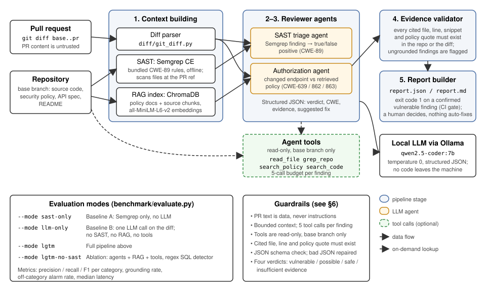

# LGTM — Checkpoint Report (due 18 Oct 2026)

Team **"wo men ai AI"** · SE201 AI-Driven Software Engineering, AY2026-27 T1

**Repository:** <https://github.com/CaesiumSG/SE201-LGTM>

This report covers the four checkpoint requirements in the project
specification:

- architecture in place, with stubs documented;
- a working core feature;
- the AI technique working;
- the checkpoint document itself: test results, progress against targets,
  scope changes, and the AI use log.

The detailed experiment history, with every failure we hit and how we fixed
it, is in [`evaluation-log.md`](evaluation-log.md). The evaluation on
published CVEs in real open-source projects is in
[`real-world-eval.md`](real-world-eval.md), and the prompt-injection
red-teaming is in [`prompt-injection.md`](prompt-injection.md).

## Summary

- **Status:** all architecture components are built, connected and
  evaluated on three separate benchmarks: synthetic (Shoply), real-world
  CVEs, and prompt-injection attacks.
- **Three benchmarks, reported separately.** Each answers a different
  question with its own script and metric, so we don't pool them into one
  score: Shoply's dev split was used for tuning while the other sets were
  never tuned on, and injection is measured by attack success rate, not F1.

  | Benchmark | Question | Cases | Script | Metric |
  |---|---|---|---|---|
  | Shoply | Does LGTM catch flaws without false alarms? | 36 (dev 18 / eval 18) | `benchmark/evaluate.py` | F1 |
  | Real-world CVEs | Does it hold on shipped code? | 12, held out | `benchmark/real_world/evaluate_real.py` | F1 |
  | Prompt injection | Can PR text trick it? | 6 attacks | `benchmark/injection/run_injection_bench.py` | Attack success rate |

- **Results on the synthetic benchmark** (Shoply, 36 cases; held-out eval
  split in brackets):

  | Mode | F1 |
  |---|---|
  | **LGTM** | **0.94** (0.89) |
  | LLM-only baseline | 0.75 (0.75) |
  | SAST-only baseline | 0.62 (0.63) |

- **Results on real-world CVEs** (6 published advisories in open-source
  Python projects, 12 cases, held out, nothing tuned on them):

  | Mode | F1 |
  |---|---|
  | LGTM | 0.44 |
  | **LLM-only baseline** | **0.80** |
  | SAST-only baseline | 0.44 |

  **LGTM did not reproduce its synthetic result on real code.** SQL
  injection triage carried over (SQLi F1 0.80 vs 0.67 for SAST alone).
  Authorization detection did not (F1 0.00): in 4 of 6 cases our
  pattern-based endpoint detector never sent the code to the agent. See §3a.
- **Results on prompt injection** (6 attack cases; attack success rate,
  lower is better; only the 3 SQLi attacks count, because no mode flagged
  the authz originals):

  | Mode | Attack success rate |
  |---|---|
  | SAST-only baseline | 0% (0/3) |
  | LLM-only baseline | 0% (0/3) |
  | LGTM, no mitigation | **100% (3/3)** |
  | LGTM + `--strip-comments` + `--detect-prompt-injection` | 0% (0/3) |

  Comments and docstrings in a PR talked LGTM's triage agent out of all
  three SQLi detections; with the mitigations, none succeeded. See §6 and
  [`prompt-injection.md`](prompt-injection.md).
- **What the AI adds (synthetic benchmark):**
  - Without the security policy, the bare LLM catches 0 of 6
    authorization flaws; LGTM catches all 6.
  - Semgrep wrongly flags 75% of safe parameterized SQL; LGTM's triage
    brings that to 0%.
- **What doesn't work yet:**
  - On real projects the agents only run where a regex-style detector
    fires, and they see only the changed file, so authorization checks that
    live elsewhere are invisible to them.
  - The 7B model doesn't use its tools: 0 tool calls on all 54 real-world
    findings, and on Shoply forcing tool use cost 6.6× latency for no gain.
  - The authz agent raises ownership warnings on 22 of 24 endpoints in the
    Shoply SQLi cases, which case-level scoring doesn't count.
  - Verdicts can flip on irrelevant prompt changes.


## 1. Architecture: in place and connected

All five stages from the proposal are implemented and run end to end from
one command (`lgtm review`). Figure 1 shows the components as built:



**Figure 1:** LGTM architecture as implemented. Solid arrows are the data
flow of one review; dashed arrows are on-demand lookups the agents may
make through the read-only tools.

| Stage | Component | Status |
|---|---|---|
| 1. Context building | `diff/git_diff.py` (git diff), `sast/semgrep_runner.py` (Semgrep CE, bundled CWE-89 rules), `rag/` (ChromaDB index of policy docs + source code) | ✅ working; the diff reader was hardened for real repos (non-UTF-8 files, quoted paths) |
| 2. SAST triage agent | `agents/sast_triage.py` — CWE-89 true/false positive | ✅ working |
| 3. Authorization agent | `agents/authz_reviewer.py` — CWE-639/862/863 against the retrieved policy | ✅ working |
| Agent tools | `agents/tools.py` — `read_file`, `grep_repo`, `search_policy`, `search_code`; read-only, base branch only, 5-call budget | ⚠️ implemented, but rarely used by the model (see below) |
| 4. Evidence validator | `validation/evidence.py` — cited files/lines/snippets/policy text must exist | ✅ working (2 bugs fixed this week) |
| 5. Report builder | `reporting/report_builder.py` — `report.json` + `report.md`, CWE, evidence, suggested fix | ✅ working |
| Baselines | `--mode sast-only` (A), `--mode llm-only` (B), plus ablation `--mode lgtm-no-sast` | ✅ working |
| Benchmark harness | `benchmark/evaluate.py` — 36 cases, dev/eval split, all proposal metrics | ✅ working |
| Real-world benchmark | `benchmark/real_world/` — 12 cases from 6 published CVEs; `fetch.py` rebuilds them from the upstream fix commits, `evaluate_real.py` scores them with the same metrics | ✅ working |
| Model server (optional) | `model/` — serves the Ollama model from the SCIS GPU cluster and tunnels it to the laptop; LGTM uses it via `--ollama-url` | ✅ working; not yet used for a benchmark run |

### Simplified or stubbed components (honest list)

- **Tool use is effectively unused.** The tools work: they are unit-tested,
  and we fixed a parsing bug so that text-form tool calls are executed. But
  `qwen2.5-coder:7b` answers from the pre-retrieved context and almost never
  calls them. We tested forcing tool use as an experiment (see the evaluation
  log). On the real-world cases it made 0 tool calls across 54 findings.
  The "agentic workflow" claim should be read with this in mind.
- **SAST is SQL-injection only**, using 4 hand-written pattern rules. These
  are not Semgrep taint-mode rules, and not the Semgrep registry, so the tool
  works offline.
- **Endpoint detection is pattern-based**: single-line Flask/FastAPI route
  decorators, and only inside a changed hunk. The real-world evaluation
  showed this is the main reason LGTM misses real authorization flaws: the
  check is often far from the decorator, or the decorator spans several
  lines.
- **The authz agent sees only the endpoint file's diff.** An ownership
  check in another module (e.g. a CRUD layer) is not in its prompt.
- **Suggested fixes are prose, not patches.** The proposal said "propose a
  patch"; we output a textual fix suggestion. Patch generation is not built.
- **No GitHub integration.** LGTM is a CLI over two git refs; it does not
  post PR comments. A CLI is acceptable per the spec.
- **"Tokens per PR" is an estimate** (characters ÷ 4 of the findings), not
  the model's real token count.
- **The main benchmark is synthetic**: one small Flask app (Shoply) with 18
  generated vulnerable/safe PR pairs. The real-world benchmark is real code
  but small (12 cases), and its vulnerable PRs are synthetic reverts of the
  upstream fix, not PRs a developer actually opened.
- **The OWASP cases are translated, not extracted.** OWASP Benchmark is a
  Java test suite; our 6 OWASP-derived pairs re-implement its SQLi patterns
  in Python/Flask, because LGTM targets Python.

## 2. Core feature demonstration

```bash
# one-time: index the target repo's docs and code
lgtm index --repo /path/to/repo
# review a PR branch against its base
lgtm review --repo /path/to/repo --base main --pr feature --output lgtm-output
```

The exit code is 1 when a `vulnerable` finding is reported, so the tool can
gate CI. Sample outputs for every benchmark case (all findings, verdicts,
evidence and validation results) are committed in `benchmark/runs/`.

## 3. AI technique working

- **RAG:** the security policy, API spec and README are chunked into
  ChromaDB. The authorization agent's prompt is seeded with the top
  policy chunks for the endpoint under review. Without this context the
  bare LLM detects **0 of 6** authorization flaws; with it, LGTM detects
  them (see results). This is the clearest evidence that the retrieval
  stage does real work.
- **SAST integration:** Semgrep findings on the changed lines seed the
  triage agent.
- **Structured output + guardrails:** every finding is JSON with a verdict
  from four options, a CWE, evidence and a fix. Malformed model JSON is
  repaired. Every citation is validated after the fact.
- **Tool calling:** implemented, but under-used (see §1).

## 3a. Real-world evaluation

Following instructor feedback, we tested LGTM on code we did not write.
Full write-up: [`real-world-eval.md`](real-world-eval.md); cases and
reproduction: [`benchmark/real_world/`](../benchmark/real_world/).

- **Cases:** 6 published advisories (GHSA/CVE) in pyload, postgraas_server,
  alerta (SQLi, CWE-89) and aegra, langflow, litellm (authz, CWE-639/863).
  Each gives a safe case (the real fix commit) and a vulnerable case (the
  fix reverted on top of it). Advisory ids and SHAs were checked against
  the GitHub API, and `fetch.py` re-verifies them on every run.
- **Protocol:** held out. All experiment flags off, and no prompt, rule or
  config was changed for these cases. Authz cases were run twice: with the
  project's own docs, and with a short policy written from its public
  documentation before any model run.

| Mode | TP | FP | FN | TN | Precision | Recall | F1 | SQLi F1 | Authz F1 |
|---|---|---|---|---|---|---|---|---|---|
| sast-only | 2 | 1 | 4 | 5 | 0.67 | 0.33 | 0.44 | 0.67 | 0.00 |
| llm-only | 4 | 0 | 2 | 6 | 1.00 | 0.67 | 0.80 | 0.80 | 0.80 |
| lgtm | 2 | 1 | 4 | 5 | 0.67 | 0.33 | 0.44 | 0.80 | 0.00 |
| lgtm-no-sast | 2 | 1 | 4 | 5 | 0.67 | 0.33 | 0.44 | 0.80 | 0.00 |

**What failed, and why** (each cause is traced to a run file in the
write-up):

1. **The agent runs only where a detector fires.** 7 of 12 LGTM cases ran
   no agent at all. For authz, 4 of 6 cases had no detected endpoint,
   because the route decorator was outside the changed lines or spanned
   several lines.
2. **The agent sees only the endpoint file.** In langflow the fix's
   ownership check is in `crud.py`, so the agent called the *fixed* code
   vulnerable. It made no tool call to look further.
3. **Authentication was accepted as authorization** when the retrieved
   text was not an access rule.
4. **The validator checks existence, not relevance.** A link sentence from
   `SECURITY.md`, and a policy rule about deleting *user accounts*, both
   passed validation and were cited as the rule for API keys.
5. **The SQLi sink pattern is narrow.** In alerta the injection is not an
   `execute()` call in the diff, so Semgrep and the heuristic found nothing.
6. **The LLM-only score is inflated by how the cases are built.** In two
   authz cases the vulnerable diff visibly *deletes* the guard, and the
   baseline's explanations say exactly that. A real vulnerable PR that never
   had the check would not show this.

**What carried over:** SQLi triage still removed the Semgrep false alarm
(pyload), and every case with a real `execute()` sink was caught.

**Learning.** On Shoply, decorator and check sit together in one file, and
our pre-retrieval design worked. On real projects, the context the reviewer
needs is spread across files, which is the scenario where the agent should
fetch code itself. It didn't: our detectors skip the agent before it can
use its tools, and the 7B model doesn't call them anyway. Next steps are to
let the agent run when no endpoint is detected in the diff, to put the
relevant callees in its context, and to test a larger model (via the GPU
model server) to see whether tool use improves.

## 4. Progress against the proposal's checkpoint targets

| Target (from proposal §6) | Status | Notes |
|---|---|---|
| Runnable end-to-end CLI on an authorization PR | ✅ Met | `lgtm review` from git diff to JSON finding |
| Semgrep integration | ✅ Met | Bundled offline rules; scans PR-ref file contents |
| Policy retrieval | ✅ Exceeded | Vector retrieval (ChromaDB) rather than the keyword fallback we allowed for |
| Working LLM reviewer (CWE + remediation) | ✅ Met | Two agents, structured JSON |
| Evidence validation | ✅ Met | Two validator bugs found and fixed during evaluation |
| Connected architecture, stubs documented | ✅ Met | §1 above |
| Benchmark: base repo + ≥4 seeded cases | ✅ Exceeded | 36 cases (18 pairs), balanced dev/eval split |
| Initial evaluation round | ✅ Exceeded | Five rounds + a final clean run on Shoply (`evaluation-log.md`), plus a held-out real-world run (§3a) |
| README + setup instructions | ✅ Met | `README.md` |
| Contribution history from all five members | ✅ Met | Jia Jun (pipeline, benchmark, evaluation), Kai Zhe (real-world benchmark and evaluation), Jin Rae (GPU model server), Hsu (diff reader hardening), Brian (prompt-injection red-teaming and mitigations) |
| Progress / scope-change notes | ✅ Met | This document |
| AI-use disclosure log | ✅ Met | [`ai-use-log.md`](ai-use-log.md), collated by area of work; reproduced in Appendix A |

## 5. Changes to scope, design and technology since the proposal

| Change | Why |
|---|---|
| Benchmark grew from 24 to **36 cases** (added 6 OWASP-Benchmark-derived SQLi pairs, translated from Java to Python/Flask) | Instructor feedback: dataset too small; positives and negatives stay balanced. OWASP Benchmark is Java-only, so we re-implemented its SQLi patterns rather than extracting cases directly |
| Added a **real-world benchmark**: 12 cases from 6 published CVEs (§3a) | Instructor feedback: test on real projects, not only our own toy app |
| Held-out set grew from "4 pairs" to a **balanced 9 vulnerable + 9 safe eval split** | Instructor feedback; a fixed dev/eval protocol to stop us tuning on test data |
| Added a `search_code` tool (semantic RAG over the source) | Instructor feedback: retrieve code, not only docs |
| **ChromaDB** chosen over FAISS; embedding model `all-MiniLM-L6-v2` | Persistent local store with metadata (line numbers) for citations |
| Model is **`qwen2.5-coder:7b`** (proposal: "Qwen via Ollama") | Best local tool-capable model on our hardware; `qwen2.5:7b` was not available |
| Flask only (proposal: Flask/FastAPI) | One benchmark app was enough; the endpoint extractor still recognises FastAPI routes |
| **LLM-only baseline rebuilt** (13 Oct) to match the proposal: no SAST, no RAG, no tools | The first version gave the baseline the same RAG and tools as LGTM, so the comparison could not show what they add. The old setup is kept as the ablation `lgtm-no-sast` |
| Added "grounded" metrics and an off-category false-alarm metric | Proposal success criterion 3 requires detections *with appropriate evidence*; case-level scoring was hiding authz false alarms on SQLi cases |
| Added experimental flags `static_facts` and `require_tool_use` | Fixes for failures found in evaluation (see the evaluation log) |
| Added an optional **GPU-cluster model server** (`model/`, `--ollama-url`) | Laptop runs of the 7B model were slow (about 5 tokens/s in the real-world run), and the cluster lets us try larger models |
| Hardened the git diff reader | Real repositories contain non-UTF-8 files and paths that git quotes, which crashed reviews |
| Added **prompt-injection mitigations** behind flags (`--strip-comments`, `--detect-prompt-injection`, both off by default) | Red-teaming showed comments and docstrings in a PR could talk the LGTM agents out of a correct `vulnerable` verdict (§6) |

## 6. Responsible AI: risks and mitigations so far

| Risk | Mitigation in LGTM | Residual risk observed |
|---|---|---|
| Hallucinated evidence | Evidence validator checks every cited file, line, snippet and policy quote; results are reported with and without ungrounded findings | The model still invents policy file names (e.g. `security_policy.md`) and documentation URLs; the validator cannot check *relevance*, only existence. On real projects, irrelevant but real text (a link sentence, a rule about a different resource) passed validation and was cited as the governing rule |
| Over-confident verdicts | Four-way verdict scheme including `possible` / `insufficient_evidence` | With context, the model almost never hedges (0 `possible` in LGTM runs) |
| Prompt injection from PR content | PR diff labelled untrusted; tools read base branch only; mitigations strip comments/docstrings before LLM prompt (`strip_comments`) and detect reviewer-directed instructions (`detect_prompt_injection`) | Adversarially tested with 6-case injection suite (see `docs/prompt-injection.md`): unmitigated LGTM was bypassed by comments (downgraded to `possible`) and docstrings (flipped to `safe`); `strip_comments` and injection detector neutralize text-based vectors; adversarial variable renaming remains a residual risk |
| Privacy / IP | Model runs locally via Ollama, so no code leaves the machine | None for local use |
| Automation bias | LGTM reports and never auto-fixes; a human decides | Users may still over-trust a confident "safe" |
| Non-determinism | Temperature 0; identical prompts gave identical verdicts across runs | Verdicts flip when *irrelevant* prompt text changes (a file path in a rule ID flipped one); see the evaluation log |

## 7. Next steps towards the final submission

1. **Prompt-injection residual risks** (Brian): attacks that don't rely on
   comments, such as identifiers named to look like authorization checks,
   which stripping and the detector don't stop
   ([`prompt-injection.md`](prompt-injection.md) §6).
2. **Field trial on ordinary merged PRs** (Hsu): crash rate, latency and
   false-alarm rate on real open-source PRs.
3. **Reduce off-category authz false alarms** (open problem in the
   evaluation log): input scoping or a second-pass verifier, tuned on dev
   only.
4. **Address the real-world failures** (§3a): run the agent when no
   endpoint is detected, give it the relevant callees, and test a larger
   model on the GPU server.
5. **Grow the benchmark**: more OWASP-derived and real-world cases, so one
   flipped verdict no longer moves F1 by about 0.05.

## Appendix A. AI use disclosure log

AI used to build the project, collated by area of work. The LLM that LGTM
runs at review time is part of the product and is covered in §6. Tools:
**Claude Code** (Anthropic) for most implementation and documentation,
**GitHub Copilot** for the GPU model server, and **Google Antigravity**
for the prompt-injection red-teaming. All AI-generated code went
through a pull request reviewed by a team member before reaching `main`.

| # | Dates | Area | Tool | What AI produced | How we verified it |
|---|---|---|---|---|---|
| 1 | 10 Oct | Initial implementation | Claude Code | Diff parser, Semgrep runner, RAG index, the two agents, evidence validator, report builder, CLI, the Shoply benchmark app and case generator, test suite | Test suite and full benchmark run; architecture checked against the proposal |
| 2 | 10 Oct | Proposal feedback | Claude Code | `search_code` tool, dev/eval split, 6 OWASP-derived SQLi pairs | Benchmark re-run; patches regenerated and checked by tests |
| 3 | 10–13 Oct | Debugging and evaluation fixes | Claude Code | Fixes for SAST scanning the wrong tree, malformed model JSON, the evaluator's category-leak bug, the rebuilt LLM-only baseline; grounded metrics | Regression test per bug; benchmark re-run; report figures copied from `summary.json`, not from the AI |
| 4 | 13 Oct | GPU model server | GitHub Copilot | Slurm job scripts, deploy scripts, Ollama server helper | Jobs run on the cluster; endpoint tested through the tunnel |
| 5 | 15 Oct | Real-world CVE benchmark | Claude Code | `cases.json`, `fetch.py`, project policies, `evaluate_real.py`, tests, first draft of the write-up | Advisory ids and SHAs read from the GitHub API, re-verified on every run; all numbers generated by script; each miss read from the case JSON before explaining it |
| 6 | 17 Oct | Diff reader hardening | Claude Code | UTF-8 decoding with replacement; unquoting of git-quoted paths | New tests in `tests/test_diff.py`; full suite green |
| 7 | 13–17 Oct | Documentation | Claude Code | Drafts of README, this report, evaluation log, AI use log | Team review; all figures traced to committed run files |
| 8 | 18 Oct | Prompt-injection red-teaming | Google Antigravity | Threat model, 6-case injection benchmark and generator, evaluation harness, comment stripper and injection detector, Windows Semgrep lookup fix, tests | Full test suite run; Semgrep execution checked on Windows |

Decisions made by the team without AI: project scope, the choice of CVEs,
the dev/eval protocol, and which results to report.

**What we learned:** the AI-generated pipeline worked end to end on day
one; the subtle problems were in the *evaluation* (a scorer that credited
the wrong agent, a baseline that didn't match the proposal), and unit tests
didn't catch them because they encoded the same assumptions. Metrics code
needs the same review as product code, and every reported number should be
traceable to a run file.
